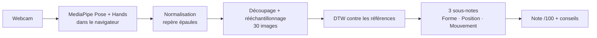

# Signa : apprendre la LSF avec un coach IA

Signa est un SaaS d'apprentissage de la **Langue des Signes Française**. L'élève regarde un signe,
le refait devant sa webcam, et une IA lui donne une note sur 100 et des corrections concrètes
(« ta main est trop haute », « fais un mouvement plus ample », « ce signe se fait à deux mains »).

**L'analyse vidéo tourne entièrement dans le navigateur.** Aucune image ne quitte l'appareil.

| Fonctionnalité | Où |
|---|---|
| Page d'accueil | `app/page.tsx` |
| Comptes (e-mail + mot de passe) | `app/connexion`, Supabase Auth |
| 5 leçons, 30 signes (2 leçons gratuites, 3 Premium) | `content/curriculum.ts` |
| Exercice avec webcam, note et corrections | `app/apprendre/[slug]` |
| Tableau de bord : signes validés, série, XP, activité | `app/progression` |
| Abonnement Premium (Stripe Checkout + portail client) | `app/tarifs`, `app/api/*` |
| Studio admin : enregistrer les signes de référence, export du dataset | `app/studio` |

---

## 1. Lancer l'app en 2 minutes (mode démo)

Il faut [Node.js](https://nodejs.org) 20 ou plus.

```bash
npm install
npm run dev
```

Ouvre http://localhost:3000. Sans configuration, l'app tourne en **mode démo** : pas de compte,
données gardées dans le navigateur, abonnement simulé. Parfait pour développer et faire une démo.

**Première étape obligatoire : enregistrer des références.** L'IA compare l'élève à des exemples.
Va dans **Studio**, choisis un signe, clique « Enregistrer une référence », fais le signe, puis
« Garder cet enregistrement ». Fais-le 2 ou 3 fois par signe. Ensuite, va dans **Apprendre**.

> Pour que l'app enseigne de vrais signes, les références doivent être faites par une personne qui
> signe couramment (sourde, interprète, enseignant LSF). Le bouton « Vérifier sur Elix » ouvre le
> dictionnaire en ligne pour contrôler chaque geste.

Tests du moteur de notation : `npm test` (13 tests).

---

## 2. Comment fonctionne l'IA



1. **Suivi du squelette** (`lib/tracker.ts`) : MediaPipe détecte 33 points du corps et 21 points par main,
   30 fois par seconde, sur le GPU de l'utilisateur.
2. **Normalisation** (`lib/features.ts`) : origine au milieu des épaules, unité = largeur d'épaules.
   La note ne dépend donc ni de la distance à la caméra ni de la position dans l'image.
   C'est exactement le même vecteur de 203 valeurs que dans le projet Python `signa-lsf`.
3. **Comparaison par DTW** (`lib/scoring.ts`) : le *Dynamic Time Warping* aligne l'essai et la référence
   dans le temps. Signer plus lentement ou plus vite n'est donc pas pénalisé.
4. **Diagnostic** : le long de l'alignement, trois écarts sont mesurés séparément.
   - *Forme* : position des doigts par rapport au poignet, à l'échelle de la main.
   - *Position* : où est la main par rapport au corps.
   - *Mouvement* : trajectoire du poignet, position moyenne retirée.
   Chaque écart devient une sous-note, puis un conseil en français.

**Pourquoi pas un réseau de neurones classifieur ?** Pour apprendre, la question n'est pas « quel signe
est-ce ? » mais « à quel point ce geste est-il correct, et qu'est-ce qui cloche ? ». La comparaison à des
références est **few-shot** : un nouveau signe s'ajoute avec 2 ou 3 enregistrements, sans réentraîner
de modèle. Elle est aussi **explicable**, puisque chaque sous-note a un sens. Le classifieur GRU du projet
`signa-lsf` reste utile pour la reconnaissance libre (voir section 6).

### Calibrer la notation

Les seuils sont dans `lib/scoring.ts` (`HALF_SCORE_COST` = écart qui donne 50/100). Les valeurs fournies
sont des valeurs de départ. Pour les calibrer avec de vraies données :
- dans le Studio, la « cohérence entre références » doit être d'au moins 80 quand une même personne refait le même signe ;
- fais signer quelques personnes « bien » et « mal », et ajuste les seuils pour séparer les deux groupes.
  C'est une expérience intéressante à présenter dans un rapport.

---

## 3. Passer en production : Supabase (comptes + base de données)

1. Crée un projet gratuit sur [supabase.com](https://supabase.com).
2. **SQL Editor > New query** : colle le contenu de `supabase/schema.sql`, puis clique **Run**.
3. **Project Settings > API** : copie l'URL, la clé `anon` et la clé `service_role`.
4. Copie `.env.example` en `.env.local` et remplis :
   ```
   NEXT_PUBLIC_SUPABASE_URL=...
   NEXT_PUBLIC_SUPABASE_ANON_KEY=...
   SUPABASE_SERVICE_ROLE_KEY=...      # secrète : jamais côté navigateur
   ```
5. Relance `npm run dev`, crée ton compte sur `/connexion`, puis donne-toi les droits admin dans le SQL Editor :
   ```sql
   update public.profiles set is_admin = true
   where id = (select id from auth.users where email = 'ton@email.fr');
   ```
6. Enregistre tes références dans le Studio. Si tu en as faites en mode démo, exporte-les en JSON
   avant de configurer Supabase, puis réimporte-les.

**Sécurité** : les droits sont vérifiés dans la base par des règles RLS (Row Level Security).
Un utilisateur gratuit ne peut pas lire les références des leçons Premium, même en modifiant le code
dans son navigateur. Personne ne peut se déclarer Premium ou admin lui-même : seul le webhook Stripe,
côté serveur, modifie le statut Premium.

---

## 4. Paiement : Stripe (en mode test)

1. Crée un compte [Stripe](https://dashboard.stripe.com) et reste en **mode test**.
2. **Catalogue de produits > Ajouter un produit** : « Signa Premium », prix récurrent 6,99 €/mois.
   Copie l'identifiant du prix (`price_...`).
3. **Développeurs > Clés API** : copie la clé secrète `sk_test_...`.
4. Dans `.env.local` :
   ```
   STRIPE_SECRET_KEY=sk_test_...
   STRIPE_PRICE_ID=price_...
   ```
5. **Webhook en local** avec la [Stripe CLI](https://docs.stripe.com/stripe-cli) :
   ```bash
   stripe listen --forward-to localhost:3000/api/webhook
   ```
   Copie le `whsec_...` affiché dans `STRIPE_WEBHOOK_SECRET`.
6. Teste avec la carte `4242 4242 4242 4242`, n'importe quelle date future et n'importe quel CVC.
7. Pour le portail client (résiliation) : **Paramètres > Billing > Portail client > Activer**.

---

## 5. Mettre en ligne sur Vercel

1. Pousse le projet sur GitHub (le `.gitignore` exclut déjà `.env.local`).
2. Sur [vercel.com](https://vercel.com) : **Add New > Project**, puis importe le dépôt.
3. Ajoute les mêmes variables d'environnement, avec `NEXT_PUBLIC_SITE_URL=https://ton-app.vercel.app`.
4. Dans Stripe, crée un webhook vers `https://ton-app.vercel.app/api/webhook` avec les événements
   `checkout.session.completed`, `customer.subscription.updated` et `customer.subscription.deleted`.
   Mets son secret dans `STRIPE_WEBHOOK_SECRET`.
5. Dans Supabase, **Authentication > URL Configuration** : mets l'URL du site.

La webcam exige le **https** (ou `localhost`). Vercel le fournit automatiquement.

---

## 6. Lien avec le projet de recherche `signa-lsf` (Python)

Le Studio est aussi un **outil de collecte de dataset**. « Exporter le dataset (JSON) » produit un fichier
que tu peux convertir pour entraîner le GRU avec attention :

```bash
python scripts/templates_to_npy.py signa-references-2026-10-29.json ../signa-lsf/data
cd ../signa-lsf && python -m src.train
```

Pense à ajouter aussi une classe `_rien` (gestes neutres) avec `python -m src.collect --signs _rien`.

Tu peux ainsi comparer dans ton rapport deux approches sur les **mêmes données** :
le DTW few-shot (explicable, sans entraînement) et le GRU supervisé (meilleur avec beaucoup de données).

---

## 7. Structure du code

```
app/
  page.tsx                 accueil
  connexion/               connexion / inscription
  apprendre/               liste des leçons
  apprendre/[slug]/        exercice : webcam, note, conseils
  progression/             tableau de bord
  tarifs/                  offres + paiement
  studio/                  enregistrement des références (admin)
  api/checkout|portal|webhook   routes Stripe (serveur)
components/                caméra, lecteur de squelette, note, navigation
content/curriculum.ts      leçons et signes
lib/
  features.ts              normalisation des points clés (identique au Python)
  scoring.ts               DTW + notation + conseils
  tracker.ts               MediaPipe dans le navigateur
  draw.ts                  dessin des squelettes
  progress.ts              XP, série, signes validés
  store/                   données : demo.ts (navigateur) ou supabase.ts
  server.ts                outils serveur (Stripe, Supabase admin)
supabase/schema.sql        tables + règles de sécurité
tests/scoring.test.ts      tests du moteur de notation
scripts/templates_to_npy.py   export Studio -> dataset Python
```

---

## 8. Limites et pistes

- **Signes isolés uniquement**, pas de phrases ni de grammaire LSF (espace de signation, classificateurs).
- **Les expressions du visage**, essentielles en LSF, ne sont pas notées. Prochaine étape : ajouter
  MediaPipe FaceLandmarker (sourcils, bouche).
- **Les seuils de notation** doivent être calibrés avec de vrais signeurs (section 2).
- **Les liens Elix** suivent le format `dico.elix-lsf.fr/dictionnaire/<mot>`. Vérifie-les : certains mots
  ont plusieurs signes ou une autre orthographe.
- **Le contenu doit être validé par la communauté sourde.** C'est la condition pour que le produit soit
  crédible, et un vrai argument dans un dossier.
- Idées de suite : répétition espacée (revoir les signes au bon moment), mode « quiz » (on montre le mot,
  l'élève signe sans voir le modèle), offre B2B pour les hôpitaux et les services publics avec suivi d'équipe.
